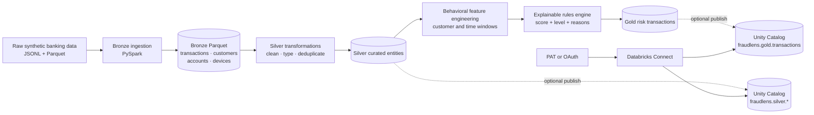
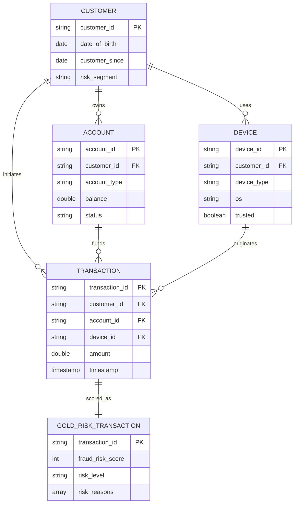

# FraudLens AI — Explainable Fraud Risk on Databricks

[](https://www.python.org/)
[](https://spark.apache.org/)
[](https://www.databricks.com/)
[](https://www.databricks.com/product/unity-catalog)

FraudLens is a Databricks-first banking fraud analytics pipeline that converts raw customer, account, device, and transaction data into an explainable transaction-risk dataset. It combines behavioral feature engineering with transparent rules-based scoring so every high-risk decision carries both a bounded score and human-readable reasons.

> **Data notice:** this repository is designed for synthetic banking data and portfolio demonstration. It must not be used to make real financial decisions without security review, model validation, bias testing, regulatory approval, and production monitoring.

## Problem statement

Fraud investigators need to prioritize a high volume of transactions without relying on an opaque score. Raw transaction amount alone is not enough: risk can also emerge from sudden velocity, a new device, a new beneficiary, unusual hours, or a high-risk transfer channel.

The engineering challenge is to create a governed pipeline that:

1. preserves raw banking events with ingestion lineage;
2. standardizes customer, account, device, and transaction entities;
3. computes customer-relative and time-window fraud signals;
4. assigns a consistent risk score from `0–100`;
5. explains which signals contributed to every score;
6. publishes curated Delta tables through Databricks Unity Catalog;
7. supports both PAT and OAuth service-principal authentication.

## Architecture



### End-to-end flow

| Stage | Component | Responsibility | Output |
|---|---|---|---|
| Land | Bronze ingestion scripts | Read JSONL/Parquet, retain source identity, add ingestion metadata | Four Bronze Parquet datasets |
| Standardize | Silver PySpark modules | Require identifiers, deduplicate keys, cast types, normalize categories | Transactions, customers, accounts, devices |
| Engineer | Spark windows and aggregates | Build customer baselines, transaction velocity, device, beneficiary, and time signals | Feature-enriched transactions |
| Score | Transparent rules engine | Apply weighted signals, cap scores, assign risk bands and explanations | Explainable fraud risk records |
| Publish | Databricks Connect | Create catalog/schema and write managed Delta tables | Unity Catalog Silver and Gold tables |
| Validate | Pytest and pipeline checks | Verify feature calculations, score boundaries, auth guards, and Gold shape | Repeatable quality evidence |

## Medallion layers

### Bronze — traceable source capture

Bronze scripts ingest four banking domains:

- `transactions` from Parquet shards;
- `customers` from JSON Lines;
- `accounts` from JSON Lines;
- `devices` from JSON Lines.

Every Bronze dataset receives `_ingested_at` and `_source_file` metadata before overwrite-mode Parquet persistence. Bronze keeps the source representation available for replay and investigation.

### Silver — standardized entities

Silver transformations enforce the core entity grain and data types:

| Dataset | Grain | Main controls |
|---|---|---|
| `transactions` | One transaction ID | Required transaction/customer/account/device IDs, deduplication, timestamp and amount casting, uppercase categories, fraud-label normalization |
| `customers` | One customer ID | Required ID, deduplication, date parsing, normalized risk segment |
| `accounts` | One account ID | Required account/customer IDs, deduplication, balance/date casting, normalized type and status |
| `devices` | One device ID | Required device/customer IDs, deduplication, Boolean/date casting, normalized device and OS values |

### Gold — explainable transaction risk

Gold starts at one row per trusted transaction. The pipeline calculates behavioral signals, applies the scoring policy, and explicitly selects the investigation-facing fields:

- transaction, customer, account, device, merchant, and beneficiary identifiers;
- amount, currency, transaction type, location, and timestamp;
- known fraud label and scenario when present;
- `fraud_risk_score`, `risk_level`, and `risk_reasons`.

## Domain model



## Fraud feature engineering

Features are calculated with Spark group aggregates and event-time windows:

| Feature | Definition | Analytical purpose |
|---|---|---|
| `customer_avg_transaction_amount` | Average amount by customer | Personal spending baseline |
| `customer_std_transaction_amount` | Standard deviation by customer | Amount variability context |
| `amount_vs_customer_avg` | Current amount divided by customer average | Relative amount anomaly |
| `transactions_last_30min` | Customer transaction count over trailing 30 minutes | Short-window velocity |
| `transactions_last_24h` | Customer transaction count over trailing 24 hours | Daily activity burst |
| `amount_last_24h` | Customer amount sum over trailing 24 hours | Daily monetary exposure |
| `new_device_flag` | First observed customer/device combination | Possible account takeover |
| `new_beneficiary_flag` | First observed customer/beneficiary combination | New payee risk |
| `unusual_hour_flag` | Transaction during configured late-night/early-morning hours | Temporal anomaly |
| `beneficiary_count_24h` | Beneficiary activity in a trailing 24-hour window | Payee velocity context |

Null feature values are filled deterministically before scoring. `location_change_flag` is part of the scoring contract but currently remains `0` because geographic-history comparison has not yet been implemented.

## Explainable risk scoring

The scoring engine is intentionally transparent:

| Signal | Points |
|---|---:|
| Amount exceeds 3× customer average, or a transfer of at least 500 | 35 |
| More than five transactions in 30 minutes | 20 |
| New device | 20 |
| New beneficiary | 20 |
| Unusual transaction hour | 10 |
| Location anomaly | 10 |
| `WIRE` or `E_TRANSFER` channel | 10 |

Scores are bounded to `0–100` and mapped to investigation bands:

```text
0–29   LOW
30–59  MEDIUM
60–79  HIGH
80–100 CRITICAL
```

Each triggered rule is retained in `risk_reasons`, including `AMOUNT_ANOMALY`, `HIGH_VELOCITY`, `NEW_DEVICE`, `NEW_BENEFICIARY`, `UNUSUAL_HOUR`, `LOCATION_ANOMALY`, and `HIGH_RISK_TRANSFER`.

## Databricks and Unity Catalog

Remote publication uses Databricks Connect and supports:

- personal access tokens through `DATABRICKS_TOKEN`;
- OAuth machine-to-machine authentication through client ID and secret;
- remote Spark writes when a cluster ID is available;
- automatic catalog and schema creation;
- overwrite-mode managed Delta tables.

The default catalog is `fraudlens`, with Silver and Gold schemas. The repository also documents intended Unity Catalog Volume roots in `config/databricks.yaml`.

Community Edition does not expose a compatible remote cluster for this write path. The client fails clearly instead of silently pretending that Unity Catalog publication succeeded.

## Data quality and safety controls

The current implementation includes:

1. required business-key filtering in every Silver entity;
2. deterministic key-based deduplication;
3. explicit timestamp, date, numeric, and Boolean casting;
4. normalized categorical fields;
5. required-column validation before Gold construction;
6. bounded risk scores and defined band boundaries;
7. reason codes for score explainability;
8. authentication guards that require credentials and cluster capability;
9. credential redaction utility and ignored environment files;
10. raw transaction-file validation for row count, unique IDs, fraud rows, and scenario coverage.

The current Silver code filters invalid keys rather than writing a reject/quarantine table, and it does not yet enforce cross-entity foreign keys. Those are important production-hardening items rather than hidden claims of completeness.

## Configuration

Copy the environment template:

```bash
cp .env.example .env
```

Configure Databricks using either PAT or OAuth:

```dotenv
DATABRICKS_HOST=https://<workspace>.cloud.databricks.com
DATABRICKS_HTTP_PATH=/sql/1.0/warehouses/<warehouse-id>
DATABRICKS_CATALOG=fraudlens
DATABRICKS_WAREHOUSE_ID=<warehouse-id>
DATABRICKS_CLUSTER_ID=<cluster-id>

# PAT authentication
DATABRICKS_TOKEN=

# Or OAuth service-principal authentication
DATABRICKS_CLIENT_ID=
DATABRICKS_CLIENT_SECRET=
```

Do not commit `.env`, tokens, client secrets, generated datasets, Parquet files, or logs.

## Installation and execution

Python 3.11 or newer and a compatible Java runtime are required for local PySpark validation.

```bash
python -m venv .venv
source .venv/bin/activate
pip install -r requirements.txt
pip install -e .
```

Prepare runtime directories:

```bash
python -m databricks.setup.setup_environment
```

With Bronze datasets available under `data/bronze/`, run the medallion pipeline:

```bash
python -m databricks.run_pipeline --base-dir data
```

To publish Silver and Gold tables to a configured Databricks workspace:

```bash
python -m databricks.run_pipeline --base-dir data --publish-databricks
```

Run validation:

```bash
pytest -q
```

## Repository structure

```text
config/                       Databricks catalog, schema, and storage intent
databricks/bronze/            Raw entity ingestion scripts
databricks/silver/            Typed and deduplicated entity transformations
databricks/gold/              Feature and risk dataset construction
databricks/setup/             Environment readiness
databricks/validation/        Raw transaction validation metrics
databricks/run_pipeline.py    Bronze-to-Silver-to-Gold orchestration
src/common/                   Configuration, logging, auth, and Databricks clients
src/features/                 Spark behavioral feature engineering
src/risk/                     Explainable rules-based scoring
tests/unit/                   Feature, scoring, and generator contracts
tests/integration/            Gold-pipeline and Databricks auth guards
```

## Current implementation status

| Capability | Status |
|---|---|
| Bronze entity ingestion | Implemented |
| Silver cleaning and deduplication | Implemented |
| Gold behavioral features | Implemented |
| Explainable risk scoring | Implemented |
| PAT and OAuth authentication | Implemented |
| Unity Catalog Delta publication | Implemented for cluster-backed workspaces |
| Spark feature/scoring tests | Included |
| Synthetic data-generator package referenced by tests/Makefile | Not present on this branch |
| Streamlit investigation application | Not present on this branch |
| Agent or LLM investigation workflow | Not present on this branch |
| Databricks Workflow/Asset Bundle deployment definition | Not present on this branch |

## Verification note

The repository contains 11 discovered test functions. Full local execution could not be completed during the README publication because the temporary environment ran out of disk space while building the 456 MB PySpark package. Independent source inspection also identified that the generator tests reference a `data_generator` package that is not present on this branch. The README therefore does not claim a passing build.

## License

This repository is intended for learning and portfolio demonstration. Add an explicit license, security review, data-retention policy, model governance process, and incident-response controls before any production or regulated use.
